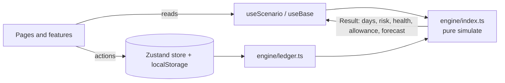

# 🪐 ORBIT — Survive the Month

> **What happens to my month if I do this?**

ORBIT is a personal finance simulator for Gen Z. You get **₹10,000 for 30 days**. Before you spend, save, subscribe or panic, ORBIT runs the decision on a copy of your month and shows what it does to your **balance, daily allowance, savings goals, month-end forecast, financial risk and financial health**. Nothing changes in your real ledger until you confirm.

Built for the *Broke But Functional — Survive the Month* challenge.

## Quick start

```bash
npm install
npm run dev        # open the printed http://localhost:5173
npm run check      # typecheck + lint + tests + production build
```

Requires Node 18+. No backend, no API keys. Data is saved in your browser (`localStorage`).

## What you can do

| Area | Page | What it does |
| --- | --- | --- |
| Income, balance, spending | **Home** | Runway ring for the 30 days, cash, free cash, allowance per day, month-end forecast, risk, health. Log money spent or received today and watch everything recalculate. Move to the next day to settle bills and planned spend. |
| Spending breakdown | **Home** | Spending by category from Day 1 onward, including what you log. |
| Financial health | **Home** | A 0–100 score split into four explained parts: buffer, bills, goal safety, spending pace. |
| Forecast | **Home** | Free-cash line to Day 30 with your buffer marked, a day scrubber, and a table alternative. |
| Simulate decisions | **Decide** | Buy, save more, add a subscription or handle an emergency. Reality translator turns rupees into Swiggy orders, allowance days and goal percent. |
| Three futures | **Decide** | Buy now, wait 7 days, or skip, side by side with a consequence chain from purchase to goal. |
| Breaking point + smart fix | **Decide** | The max safe purchase for any day, and proven fixes (cut the price, delay, cancel a subscription, trim daily spend) that you can apply. |
| Regret check + Future You | **Decide** | A letter from your future self in your money personality's voice, a mood check, then commit, park on a cooling-off list, or skip. Download a Future Card image. |
| Unexpected expenses | **Stress** | Exam week, birthday, trip, phone repair, festival season, or your own shock. Risk heatmap shows which days break. |
| Savings goals | **Plan** | Multiple goals with progress. Money moved into a goal leaves your daily allowance. |
| Commitments + subscriptions | **Plan** | Add or remove bills, subscriptions and income. Subscription autopsy shows cost per use and what cancelling does to your month. |
| Decision journal | **Journal** | Impulse buys avoided, cooling-off list, buffer and planned-spend settings, data export, reset. |

Everything is connected: change one number anywhere and the allowance, forecast, risk and health update everywhere.

## How it works



- **`src/engine/index.ts`** is a pure simulation engine with no UI and no side effects. `simulate()` runs on a clone, so asking "what if" can never change the real month. `commit()` is the only function that returns a changed ledger.
- **`src/engine/ledger.ts`** holds the operations that change the real month (log spend, add a goal, advance a day) as pure functions that return a new ledger.
- **`src/store`** keeps the real ledger, journal, cooling-off list and the sandbox decision, persisted to the browser.
- **`src/hooks/useScenario.ts`** derives everything the screens need from the sandbox, memoised.
- **`src/pages` and `src/features`** are small, focused components. Each page is lazy-loaded.

Full details: [docs/ARCHITECTURE.md](docs/ARCHITECTURE.md) · [docs/ENGINE.md](docs/ENGINE.md) · [docs/ACCESSIBILITY.md](docs/ACCESSIBILITY.md) · [docs/DEMO.md](docs/DEMO.md)

### The rules in one place

- **Free cash** = cash − money reserved for goals.
- **Daily allowance** = (Day-30 free cash + planned spend × days − buffer) ÷ days left, never below ₹0.
- **Risk** — Chill: lowest free cash ≥ 2× buffer. Tight: between buffer and 2× buffer. Risky: below buffer, a bill goes unpaid, or free cash goes negative (touching savings).
- **Health (0–100)** = buffer 30 + bills covered 25 + goal safety 25 + spending pace 20. It is an app indicator, not a credit score.

## Design

- **Signature element:** the runway ring on Home. One segment per day, past days dimmed, future days coloured by risk, today highlighted, and your safe daily spend in the middle.
- **Tokens:** dark by default, light on request or by system setting, all defined as CSS variables in `src/index.css`.
- **Risk is never colour-only.** Chill ●, Tight ▲, Risky ■ always carry a label.
- **Responsive:** one column with a bottom tab bar on phones; side rail and two-column cards from 760px. No horizontal scrolling, 44px touch targets, safe-area aware.

## Accessibility

Skip link, landmarks (`header`, `nav`, `main`), `aria-current` navigation, focus moved to the page title on route change, every input has a visible label, errors are linked with `aria-describedby`, status messages use a polite live region, charts have text summaries and a data table, meters use `role="meter"`, visible focus rings, `prefers-reduced-motion` and forced-colors support. `eslint-plugin-jsx-a11y` runs in `npm run lint`.

## Performance

- Every page is its own chunk (`React.lazy`), and the chart library is split into a separate chunk loaded only when a chart is on screen.
- Removed the animation library; motion is a single CSS reveal that respects reduced motion.
- System font stack (no web-font download), inline SVG icons, no images.
- Simulations are memoised with `useMemo` on the inputs that matter.

## Testing

```bash
npm test
```

- `engine.test.ts` — the original 7 engine tests (sample load, three futures, exam week, max safe purchase, ledger untouched by simulation, commit/reset, day-18 shock isolation).
- `ledger.test.ts` — logging, commitments, goals, advancing days, categories, health breakdown.
- `format.test.ts` — currency formatting, safe number parsing, risk glyphs, copy helpers.

## Project structure

```
src/
  engine/        pure simulation (index.ts), ledger operations (ledger.ts), sample data (seed.ts)
  store/         Zustand stores: real ledger and sandbox
  hooks/         useScenario, useHashRoute, useTheme
  pages/         Home, Decide, Stress, Plan, Journal, Onboarding
  features/      DecisionStudio, ThreeFutures, SmartFix, FutureLetter, Goals, Commitments, Autopsy, QuickLog, ...
  components/    ui primitives, RunwayRing, charts, Notice, ErrorBoundary
  content/       stress packs and money-personality copy
  lib/           formatting and copy helpers
  tests/         vitest suites
docs/            architecture, engine, accessibility, demo script
```

## Trade-offs and next steps

- The sample month starts on Day 6 with ₹1,500 already spent so there is something to plan around. Use **Journal → Reset demo** to restart.
- Money is stored in the browser only. A real product would add an account and sync.
- Next: recurring-expense detection, weekly spending reports, and shareable goal cards.

## License

MIT
